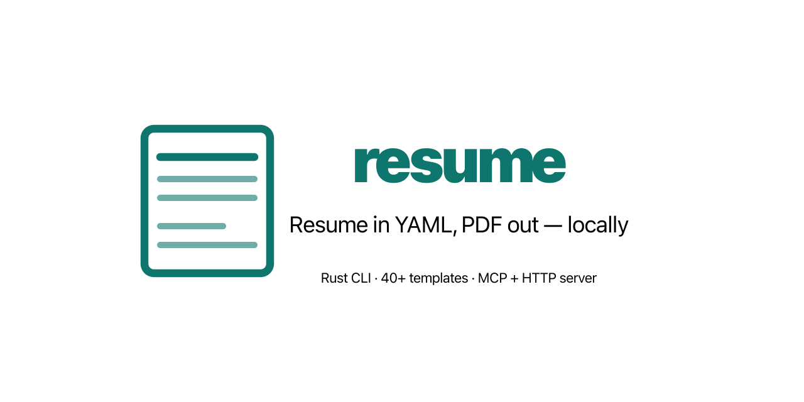

# resume — latest build



resume is a Rust CLI that turns a `resume.yaml` into Markdown, HTML (64
print-ready templates) and PDF via `wkhtmltopdf`. It also serves an HTTP API
(`resume serve`) and an MCP server (`resume mcp serve`) for LLM clients, and
`resume-core` compiles to WebAssembly for the landing page editor.

## Download

| Platform            | Asset                               |
| ------------------- | ----------------------------------- |
| Linux x86_64        | `resume-x86_64-unknown-linux-gnu`   |
| macOS Apple Silicon | `resume-aarch64-apple-darwin`       |
| Windows x86_64      | `resume-x86_64-pc-windows-msvc.exe` |

Or install from source:

```sh
./scripts/install.sh            # release binary, cargo fallback
cargo install resume-cli        # once published
```

`pdf` generation requires `wkhtmltopdf` on PATH.

## Quick start

```sh
resume init                    # create resume.yaml
resume md                      # resume.yaml -> resume.md
resume pdf -t classic/classic  # resume.yaml -> resume.pdf
resume validate                # check resume.yaml against the schema
resume serve                   # POST /api/v1/pdf (JSON -> PDF)
resume mcp serve               # MCP server over stdio
```

## Documentation

- [README](https://github.com/hieudoanm/resume#readme)
- [Landing](https://hieudoanm.github.io/resume/)
